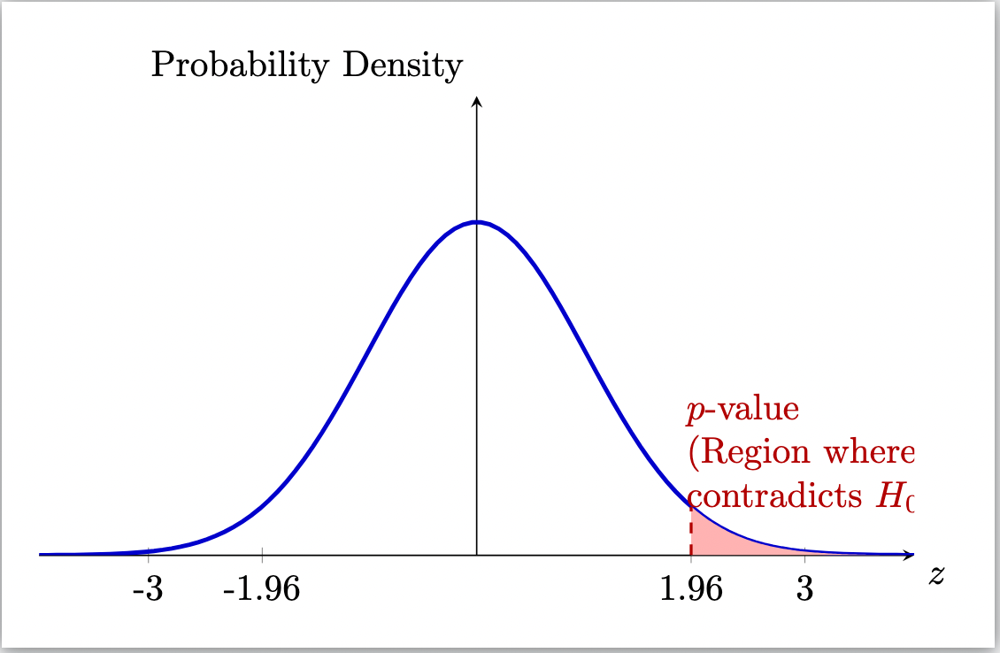
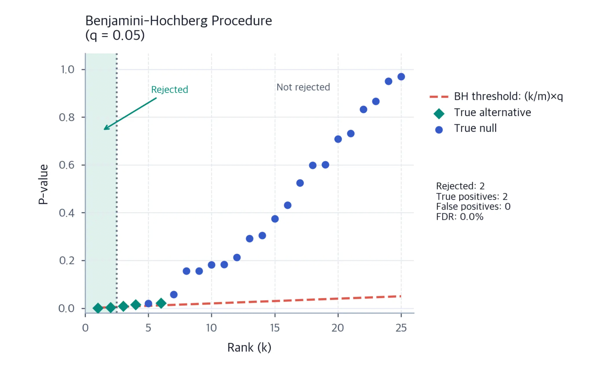
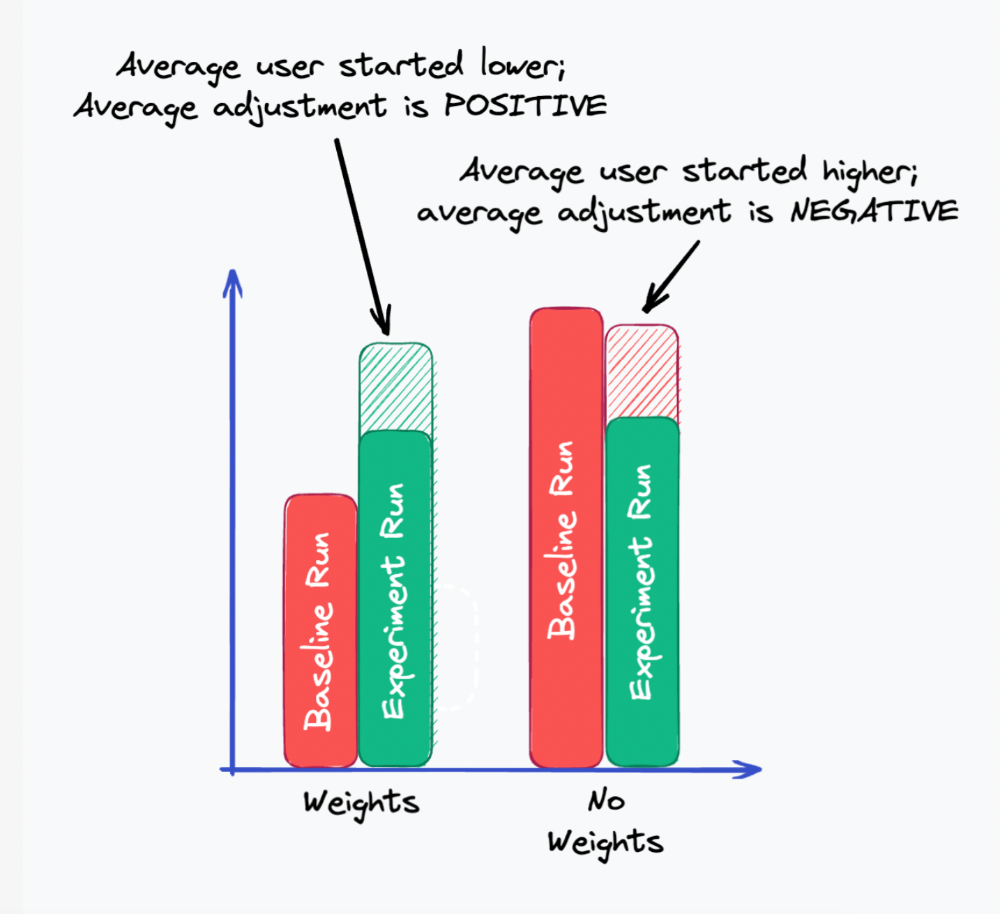

## Introduction

In statistics textbooks, the p-value seems to offer a clear verdict: if $p < 0.05$, the result is significant, and the experiment is a success. However, when I stepped into the role of a data science intern at an internet company, reality presented a very different picture. During my time running A/B tests, I frequently encountered experiments with incredibly small p-values that yielded zero actual business benefit. Conversely, genuinely effective features sometimes failed to show significance due to high variance.

This paradox reveals the most counterintuitive aspect of the p-value: it is not the probability you think it is. The most common misconception is equating the p-value with the probability that the null hypothesis is true, or $P(H_0 \mid \text{Data})$. We desperately want to know: "Given this data, what is the probability that my experiment actually worked?" But the p-value answers a completely reversed question: $P(\text{Data} \mid H_0)$, which asks, "Assuming my experiment had absolutely no effect, what is the probability of observing a difference this large purely by chance?" This is a transposed conditional probability:

$$P(\text{Data} \mid H_0) \neq P(H_0 \mid \text{Data})$$

Think of a courtroom: the p-value is not the probability that the defendant is innocent; it is the probability of finding the current evidence *if* the defendant were completely innocent. This logical inversion is why the p-value initially feels so unintuitive.

{#fig:pvalue}

## The Illusion of Significance

Understanding this helped me navigate the illusions I faced during my internship. When we simultaneously tracked dozens of metrics, even if the product changed nothing, random fluctuations meant roughly 5% of these metrics would naturally show a $p < 0.05$. This is the problem of multiple testing. To filter out these false positives, we cannot blindly trust a single p-value. For a strict control of the family-wise error rate, we use the Bonferroni correction:

$$\alpha_{\text{Bonferroni}} = \frac{\alpha}{m}$$

where $m$ is the number of hypotheses tested. Alternatively, to control the false discovery rate, we apply the Benjamini-Hochberg (BH) procedure:

$$\text{Reject } H_{(i)} \text{ if } p_{(i)} \leq \frac{i}{m} \alpha$$

{#fig:bh}

Furthermore, we used the Standardized Mean Difference (SMD) to check if our traffic split was truly uniform. If the control and experimental groups were inherently different before the test even began, the post-experiment p-value would be a misleading illusion:

$$\text{SMD} = \frac{\bar{X}_{\text{treatment}} - \bar{X}_{\text{control}}}{\sqrt{\frac{s_{\text{treatment}}^2 + s_{\text{control}}^2}{2}}}$$

## The Missing Significance

On the other hand, p-values can also fail to detect the truth. Often, a beneficial feature would be launched, but due to insufficient sample size or inherently noisy user behavior, the p-value would fail to reach significance. To address this, we applied CUPED (Controlled-experiment Using Pre-Experiment Data). It uses pre-experiment covariates to reduce variance, allowing a true effect that was previously drowned out by noise to finally emerge:

$$Y_{\text{cuped}} = Y - \theta (X - \bar{X})$$

where the optimal $\theta$ is derived as:

$$\theta = \frac{\text{Cov}(Y, X)}{\text{Var}(X)}$$

{#fig:cuped}

## Historical Context

Historically, this awkward position of the p-value is nothing new. In 1925, statistician Ronald Fisher casually suggested using a 5% threshold for agricultural experiments. He likely never anticipated that this arbitrary cutoff would become an almost sacred dogma in both academia and industry for nearly a century.

Today, the American Statistical Association explicitly warns that "a p-value does not measure the size of an effect or the importance of a result." My internship experience is a perfect testament to this. The p-value is merely a measure of "surprise." It does not represent business value, nor can it be interpreted in isolation from experimental design, traffic quality, or data variance. Understanding the counterintuitive nature of the p-value is not about rejecting it, but about approaching data—and business intuition—with a healthy dose of humility.

## References

- Brenndoerfer, M. (2026, January 9). *Multiple comparisons: FWER, FDR, Bonferroni, Holm*. Michael Brenndoerfer. <https://mbrenndoerfer.com/writing/multiple-comparisons-fwer-fdr-bonferroni-holm-benjamini-hochberg>
- Sexauer, C. (2024, September 15). *CUPED explained*. Statsig. <https://www.statsig.com/blog/cuped>
