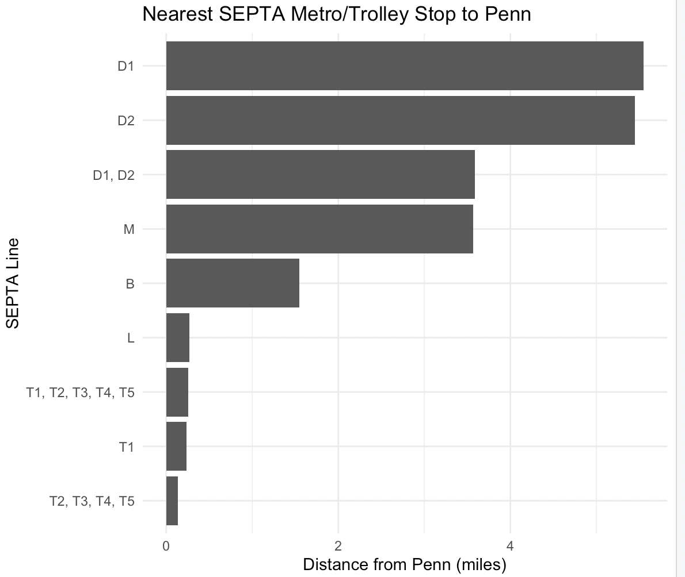
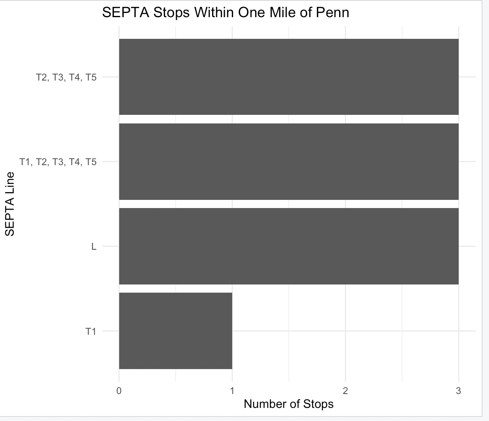
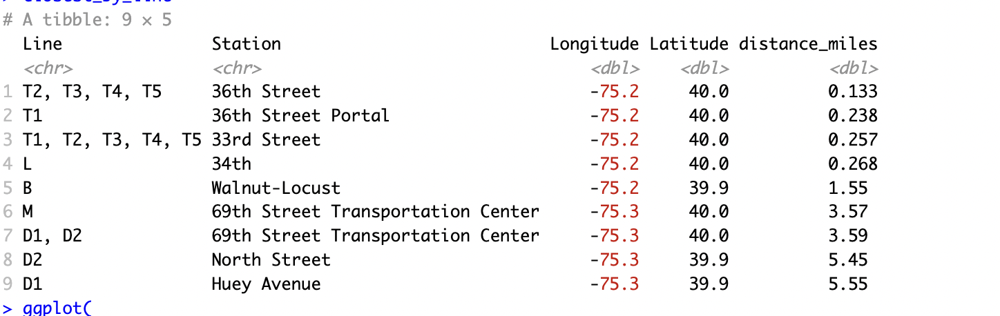

## Introduction

For a new student at the University of Pennsylvania (Penn), public transportation is an important part of getting around Philadelphia. Students may need to travel to different neighborhoods, shopping areas, restaurants, or other parts of the city. SEPTA provides several types of public transportation, including Metro and trolley services. However, for someone who is new to Philadelphia, it can be difficult to understand which lines and stations are most convenient from the Penn campus.

In this project, I used web scraping to collect SEPTA transportation information and answer a practical question: *Which SEPTA Metro and Trolley lines are most accessible to a new Penn student?*

The data came from the OpenDataPhilly website, specifically the SEPTA “Routes, Stops, and Locations” dataset. I used the `rvest` package in R to scrape the webpage and identify the available CSV data files. I then used the station and stop datasets to examine SEPTA Metro and trolley routes. The datasets contain information such as route names, station or stop names, and geographic coordinates.

For the Metro data, I used the High Speed Stations dataset. It contains information for three main routes in the dataset: B, L, and M. For the trolley data, I used the Trolley Stations dataset, which contains trolley stop names, route abbreviations, and latitude and longitude coordinates.

After collecting the data, I cleaned the datasets and combined the Metro and trolley information. I used an approximate location for the Penn campus as the reference point. Then, I calculated the approximate straight-line distance between Penn and each SEPTA station or trolley stop. This allowed me to compare the geographic accessibility of different SEPTA lines.

## Results

The first chart shows the nearest SEPTA Metro or trolley stop for each route. The trolley stops around 36th Street and 33rd Street are very close to Penn. The L Line also has a station at 34th Street, which is approximately 0.27 miles from the reference point on the Penn campus. These locations are particularly close compared with some other SEPTA routes.

{#fig-chart1 width=85%}

The B Line has a nearby station at Walnut--Locust, although it is farther from Penn than the L Line and the trolley stops. The M Line and D routes have their closest stops several miles away from Penn. Therefore, based only on geographic distance, these routes are less directly accessible from the Penn campus.

The second chart shows the number of SEPTA stops within one mile of Penn. The results show that several trolley routes and the L Line have stops within this distance. This provides another way to understand which routes may be convenient for a student who wants to walk to a SEPTA stop.

{#fig-chart2 width=85%}

The third chart provides another visualization of the SEPTA transportation data collected for this project.

{#fig-chart3 width=85%}

## Actionable Insight

For a new Penn student, the results suggest that the trolley routes around 33rd and 36th Streets and the L Line at 34th Street are geographically close to campus. These routes may therefore be useful starting points when learning how to use SEPTA.

The results also show why understanding the location of stops is useful. A student does not necessarily need to know every SEPTA route immediately. Instead, they can first learn the stations and trolley stops that are closest to campus and then use those locations as starting points for trips around Philadelphia.

However, distance alone does not determine whether a route is convenient. Travel time, destination, service frequency, transfers, and current service conditions can also affect the usefulness of a route. Therefore, this analysis should be viewed as a simple geographic comparison rather than a complete evaluation of SEPTA service.

## Limitations

There are several limitations to this analysis. First, the distance calculation is an approximate straight-line distance rather than actual walking distance. A station that is geographically close may require a longer walking route because of streets, buildings, or other obstacles.

Second, some SEPTA stops are shared by multiple trolley routes. The dataset may represent these routes together, so the route names in the charts can sometimes appear as combinations such as T1, T2, T3, T4, and T5.

Finally, the datasets used in this project are GIS datasets rather than real-time service information. SEPTA schedules and service conditions can change, so students should check current SEPTA information before planning a specific trip.

## Conclusion

This project demonstrates how web scraping can be used to answer a practical transportation question. By scraping SEPTA information from OpenDataPhilly and analyzing station locations in R, I was able to compare the geographic accessibility of different Metro and trolley routes from the Penn campus. The analysis shows that several trolley stops and the L Line are located relatively close to Penn, providing useful starting points for a new student learning to navigate Philadelphia using SEPTA.