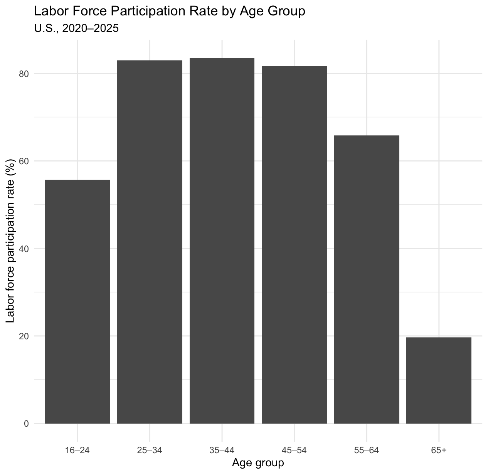
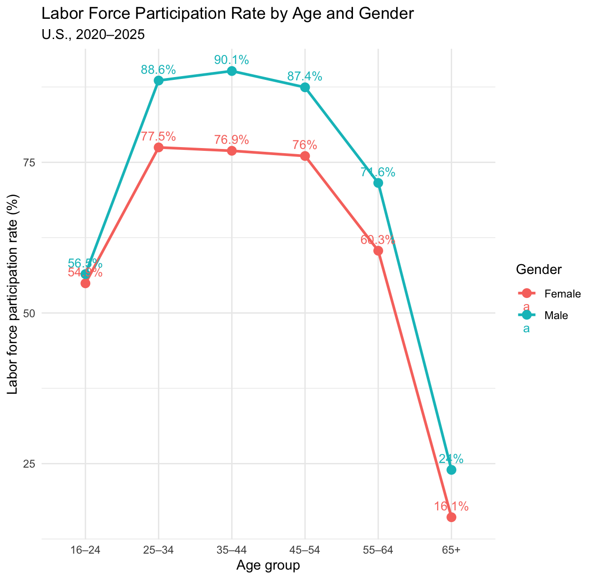
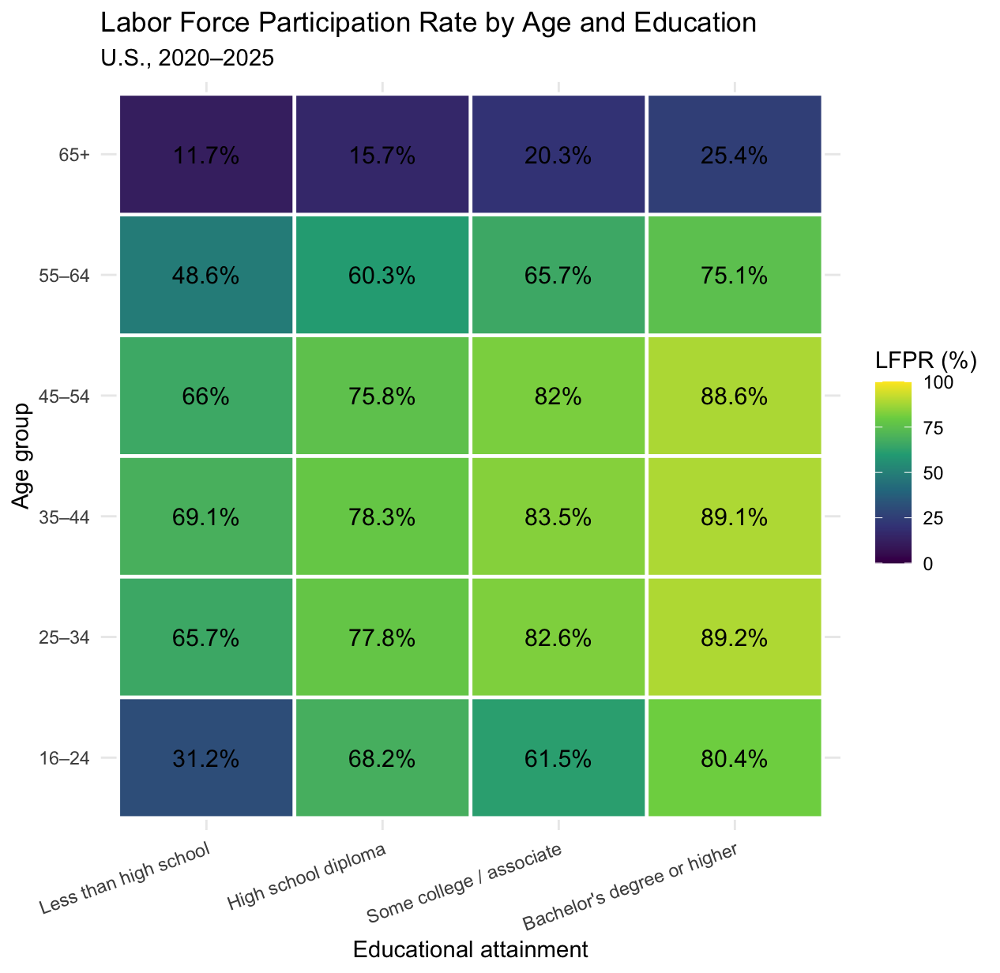
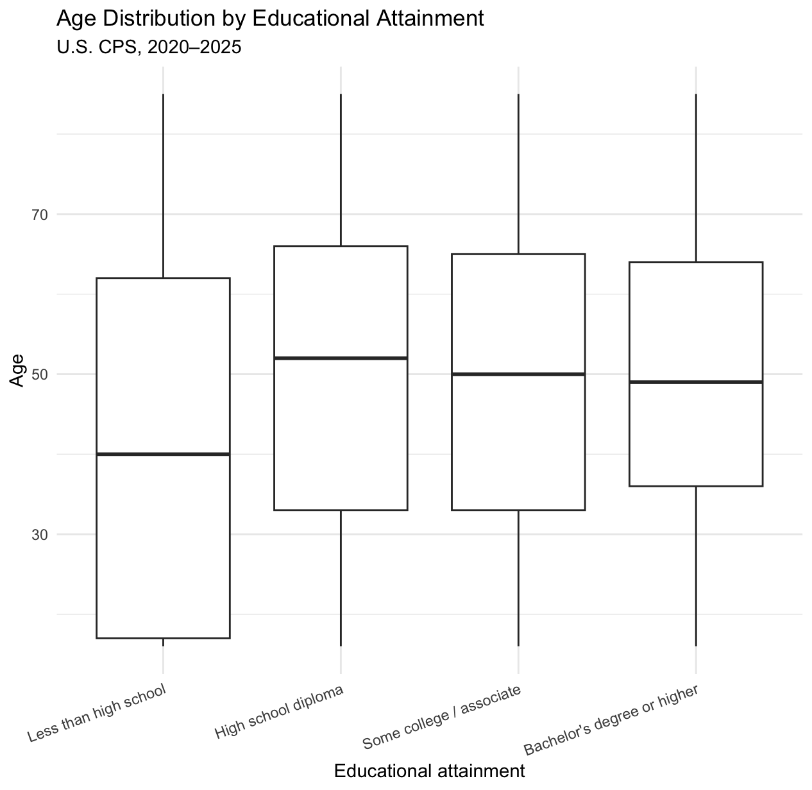
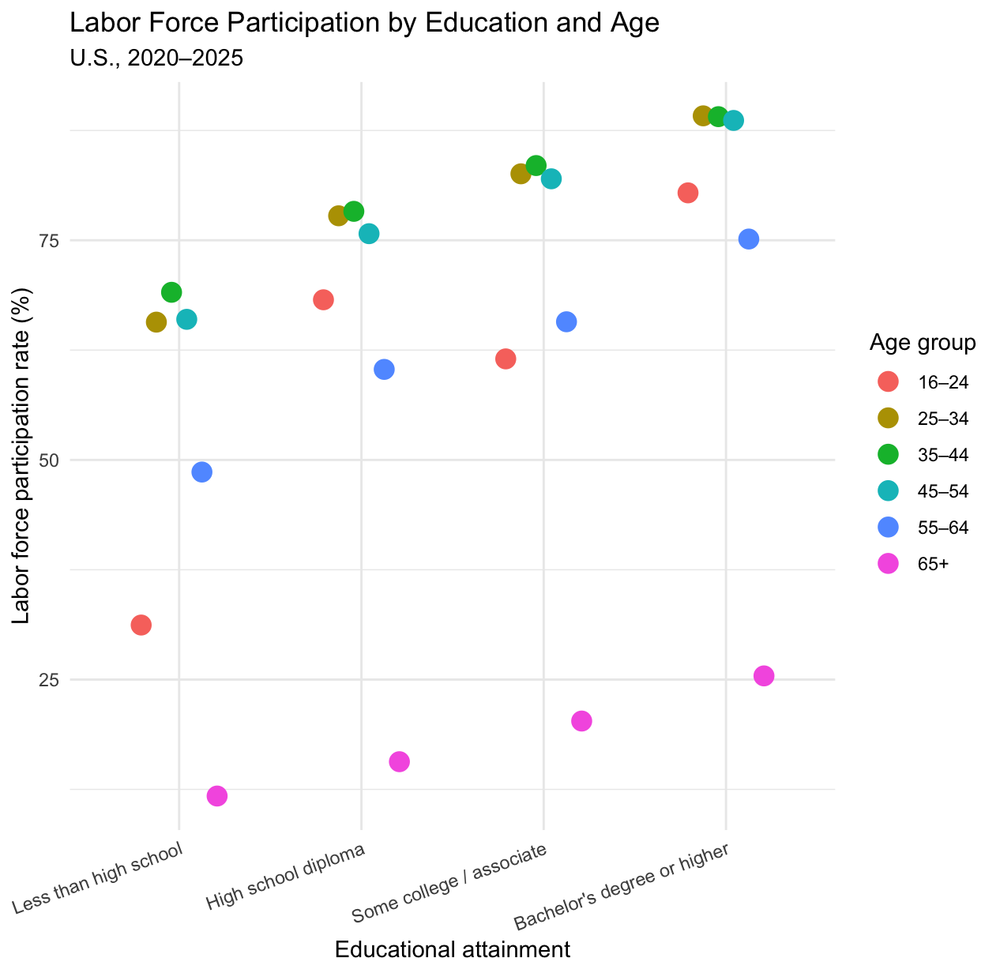
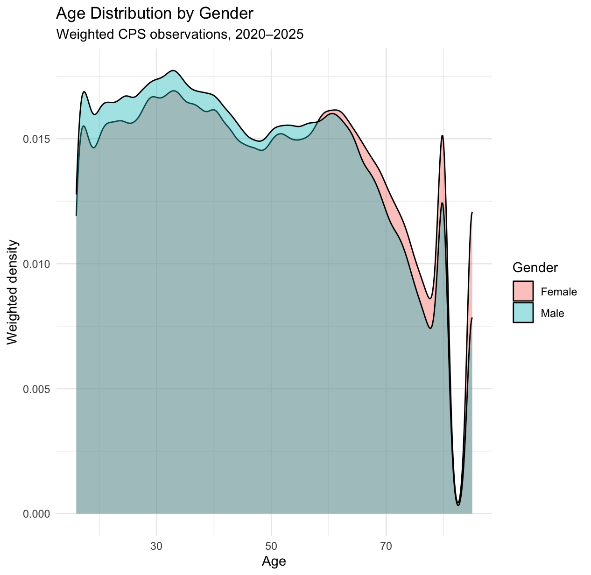

Labor force participation is an important indicator of how different groups engage with the U.S. labor market. In this post, I use IPUMS Current Population Survey (CPS) microdata to examine how labor force participation varies across age, gender, and educational attainment. The analysis uses monthly CPS observations from 2020 through 2025 and focuses on individuals age 16 and older. I use the CPS person-level final weight (`WTFINL`) when calculating participation rates so that the results reflect the U.S. population rather than simply the raw survey sample.

## Labor Force Participation Across Age

The first visualization shows a clear life-cycle pattern in labor force participation.

{#fig-chart1 width=78%}

The weighted participation rate is 55.7\% among individuals ages 16--24, but it rises sharply to 83.0\% among those ages 25--34 and 83.5\% among those ages 35--44. Participation remains relatively high among people ages 45--54 at 81.7\%, before declining to 65.8\% for ages 55--64. Among people age 65 and older, the rate falls to only 19.7\%. This pattern suggests substantial differences in labor-force attachment across stages of the life cycle. Younger people may still be completing their education, while older individuals are more likely to have left the labor force.

## Gender Differences Across the Life Cycle

The second visualization adds gender to the analysis.

{#fig-chart2 width=82%}

The age pattern differs noticeably between men and women. Among 16--24-year-olds, participation is relatively similar: 56.5\% for men and 54.9\% for women. However, the difference becomes larger among prime-age adults. For example, among people ages 35--44, participation is 90.1\% for men compared with 76.9\% for women, a difference of 13.2 percentage points. The gap remains among older workers: participation among those age 65 and older is 24.0\% for men and 16.1\% for women.

## Education and Labor Force Participation

The third visualization combines age and educational attainment.

{#fig-chart3 width=82%}

The heatmap shows substantial differences across education groups, particularly among prime-age adults. For example, among individuals ages 35--44, participation ranges from 69.1\% for those with less than a high school education to 89.1\% for those with a bachelor's degree or higher. A similar educational gradient appears among people ages 45--54 and 55--64. However, the pattern is less straightforward among younger individuals. Among 16--24-year-olds, for example, participation is 61.5\% for those with some college or an associate degree, compared with 68.2\% for those with a high school diploma. This may partly reflect the fact that many young adults are still enrolled in education.

## Conclusion

Overall, the three visualizations show that labor force participation varies substantially across the life cycle and that gender and educational attainment are associated with different participation patterns. The strongest differences appear among prime-age and older adults. These results are descriptive rather than causal, but they illustrate how CPS microdata can be used to explore important patterns in the U.S. labor market.

## Appendix: Additional Visualizations

The following figures provide additional descriptive views of the CPS data and are included as supplementary visualizations.

{#fig-chart4 width=82%}

{#fig-chart5 width=82%}

{#fig-chart6 width=82%}

## Resources

- **R Code**
  - [Read R Code (Web Preview)](blog3.R){target="_blank"}
  - [Download R Code](blog3.R){download}
- **PDF Document**
  - [Read PDF (Web Preview)](blog3.pdf){target="_blank"}
  - [Download PDF](blog3.pdf){download}