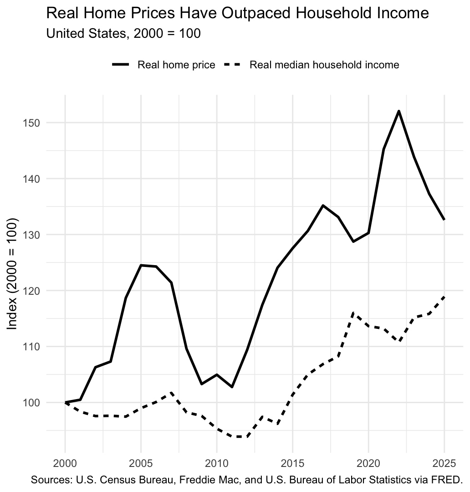
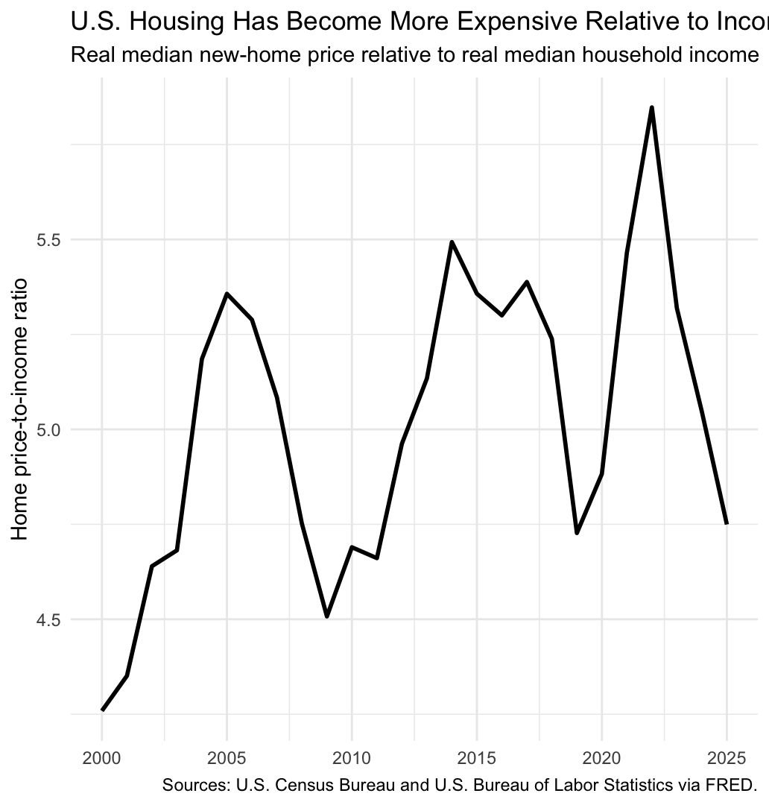
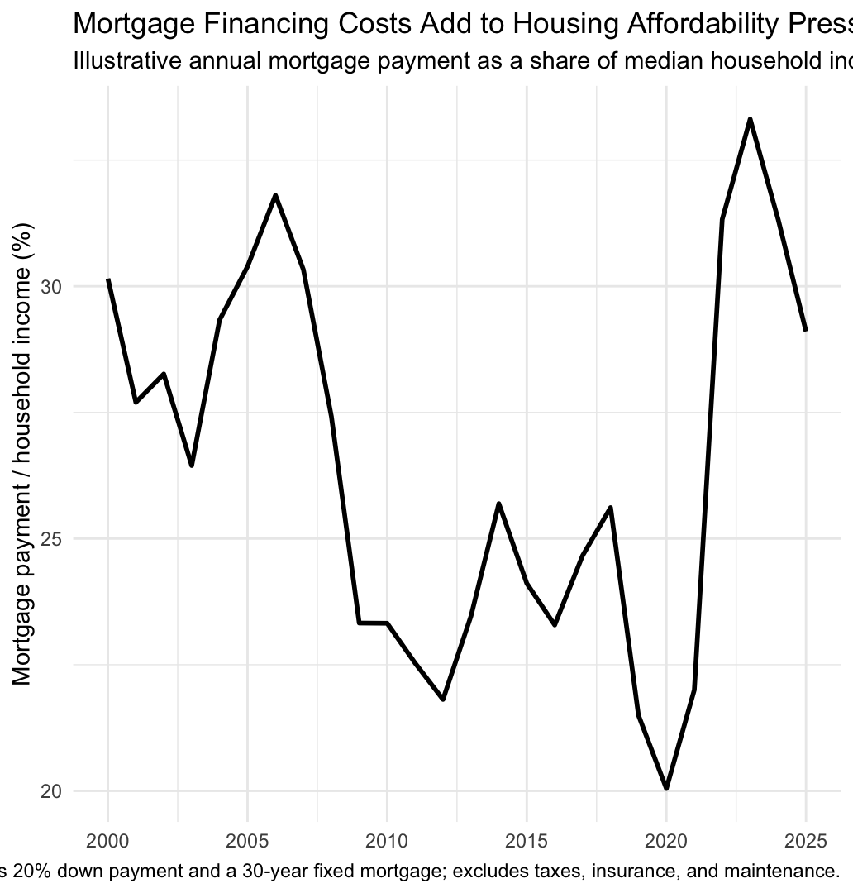

Computational Methods for Economists — Blog Post 4: Dataset of Choice

## Introduction

Housing affordability depends on more than the price of a home. It also depends on how quickly household incomes grow and how expensive it is to finance a purchase. This post asks: **How has housing affordability changed in the United States since 2000?** I use four series from the Federal Reserve Bank of St. Louis (FRED) to examine new-home prices, real median household income, consumer prices, and 30-year mortgage rates.

## Data and Approach

The analysis covers 2000–2025 and uses an R script to obtain data programmatically through the FRED API. The series are MSPUS (median sales price of new houses sold), MEHOINUSA672N (real median household income), MORTGAGE30US (30-year fixed mortgage rate), and CPIAUCSL (Consumer Price Index).

Quarterly home prices, weekly mortgage rates, and monthly CPI are converted to annual averages. Nominal home prices are converted to 2025 dollars using annual-average CPI. I then construct a 2000=100 index, a home-price-to-income ratio, and an illustrative mortgage-payment burden.

## Prices Have Risen Faster Than Incomes

{#fig-chart1 width=85%}

Figure 1 shows a persistent gap. With 2000 set equal to 100, the real new-home price index reaches about 133 by 2025, while the real median household income index reaches about 119. New-home prices therefore rose roughly 33 percent in real terms, compared with about 19 percent for real median household income.

The path was not smooth: prices fell during the housing correction after the mid-2000s boom and then increased strongly. By 2025, however, prices remained well above their income-based benchmark.

*Source: FRED, series MSPUS and MEHOINUSA672N.*

## Housing Became More Expensive Relative to Income

{#fig-chart2 width=85%}

Figure 2 puts the affordability question in relative terms. The constructed price-to-income ratio rises from 4.26 in 2000 to 4.75 in 2025, with higher readings during several periods, including around 2022.

The important point is that homes became more expensive relative to household income, not simply more expensive in nominal dollars. The ratio also shows that affordability moved with the housing cycle rather than worsening continuously.

*Source: FRED, series MSPUS, MEHOINUSA672N, and CPIAUCSL.*

## Mortgage Rates Can Amplify the Burden

{#fig-chart3 width=85%}

Figure 3 adds the financing side of affordability. Under a hypothetical 20 percent down payment and 30-year fixed-rate mortgage, the estimated annual payment was relatively low around 2020, when mortgage rates were unusually low. It then rose sharply as rates increased after 2021.

By 2025, the illustrative payment was about 29 percent of real median household income. This shows why the sticker price is not the whole story: borrowing costs can change how much income is needed to finance a purchase.

*Note: Assumes a 20 percent down payment and a 30-year fixed-rate mortgage; excludes taxes, insurance, and maintenance. Source: FRED, series MSPUS, MEHOINUSA672N, MORTGAGE30US, and CPIAUCSL.*

## Conclusion

Since 2000, U.S. housing affordability has generally deteriorated. New-home prices have grown faster than real median household income, while mortgage rates can further increase the financing burden. The deterioration was not continuous: affordability improved during the post-2008 correction and the low-rate period around 2020 before worsening again.

## Limitations

This analysis is descriptive rather than causal. MSPUS measures new-home sales, so it does not represent the entire U.S. housing market. The mortgage burden is an illustrative calculation rather than observed household spending and excludes taxes, insurance, and maintenance.

The income series is already reported as real income, while nominal home prices are explicitly converted to 2025 dollars, so the analysis focuses mainly on changes over time and relative movements rather than treating the constructed burden as a complete measure of affordability.

## Reproducibility

The accompanying GitHub repository includes the R script and all three figures. The script downloads the data programmatically from FRED, processes the series, calculates the affordability measures, and saves the figures to the `images/` folder.

## Resources

- **R Code**
  - [Read R Code (Web Preview)](blog4.R){target="_blank"}
  - [Download R Code](blog4.R){download}