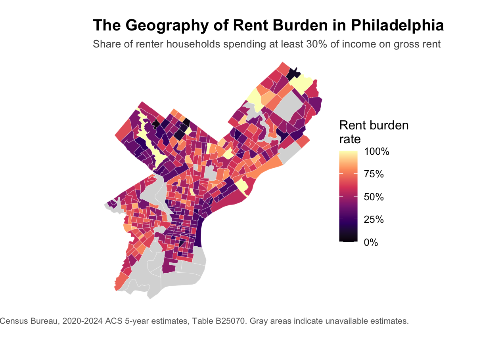
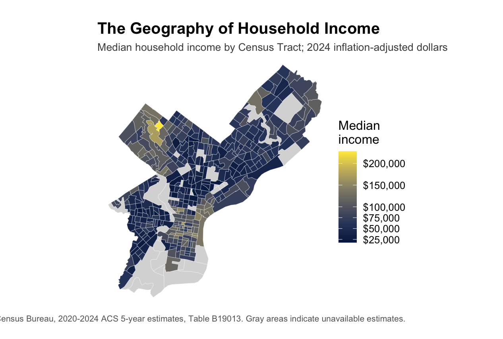
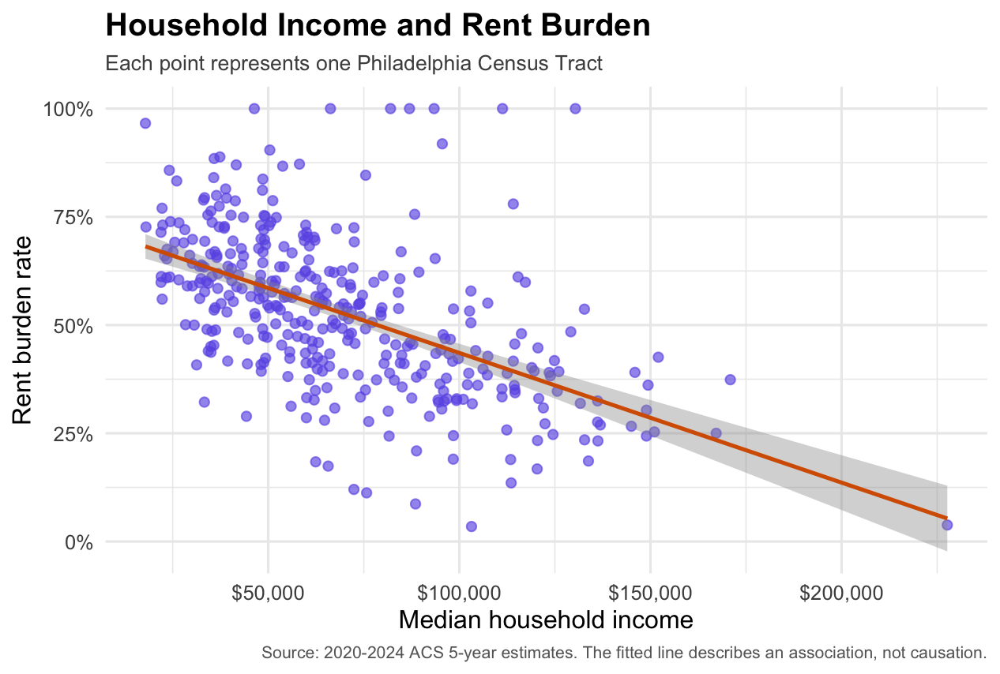

Computational Methods for Economists — Blog Post 5

# Introduction

Housing affordability is often discussed in terms of rising rents, but housing costs alone do not fully capture the financial pressure experienced by households. A more informative measure is rent burden: the share of renter households spending at least 30% of their income on gross rent. Examining this measure geographically can reveal whether housing affordability challenges are distributed evenly across a city or concentrated in particular neighborhoods.

This post explores two questions: Where is rent burden concentrated across Philadelphia, and how is its spatial distribution associated with household income?

# Data and Methods

The analysis uses the U.S. Census Bureau's 2020–2024 American Community Survey (ACS) five-year estimates at the Census Tract level. Rent burden is calculated using Table B25070, which reports gross rent as a percentage of household income. Households whose rent-to-income ratios cannot be computed are excluded from the denominator. Median household income comes from Table B19013.

Using R, I combined the estimates with Census Tract geographic boundaries and created two choropleth maps. I also constructed a scatter plot to examine the relationship between median household income and rent burden across tracts. Pearson and Spearman correlation coefficients were calculated to assess the strength and direction of this association.

# Results: A Spatially Uneven Housing Burden

The map reveals substantial variation in rent burden across Philadelphia. Some Census Tracts have considerably higher rates than others, suggesting that housing affordability challenges are not geographically uniform. Across the city, the estimated rent-burden rate is 52.3% among renter households whose rent-to-income ratios can be computed. The median tract-level rate is 54.0%, indicating that a typical tract also has a high share of rent-burdened renters.

{#fig-rent-burden}

The income map reveals another important dimension of Philadelphia's geography: household income also varies considerably across Census Tracts. Comparing the two maps suggests that understanding housing affordability requires considering both housing costs and residents' economic resources. However, visual similarities alone cannot establish why particular areas experience higher rent burdens.

{#fig-income}

# Income and Rent Burden

The scatter plot provides quantitative evidence of the relationship between household income and rent burden. Pearson's correlation is -0.546, while Spearman's correlation is -0.595. Both indicate a moderate negative association: higher-income tracts generally tend to have lower rent-burden rates. The slightly stronger negative Spearman correlation suggests that this overall pattern is also visible when comparing the rankings of tracts.

{#fig-income-rent}

Nevertheless, substantial variation remains among tracts with similar incomes. Income alone therefore does not fully explain differences in housing affordability. Other factors, including rental prices, housing characteristics, and household composition, may also be relevant, although they are not directly examined in this analysis.

# Conclusion

Philadelphia's housing affordability challenge has a clear geographic dimension. Rent burden varies substantially across Census Tracts and is negatively associated with neighborhood-level median household income. These findings highlight the importance of examining local conditions rather than relying solely on citywide averages.

This analysis is descriptive rather than causal. ACS estimates are subject to sampling uncertainty, and tract-level patterns cannot be directly interpreted as individual household experiences. Future analysis could incorporate rental prices, housing characteristics, and neighborhood demographics to better understand the factors associated with Philadelphia's uneven housing burden.

**Data source:** U.S. Census Bureau, 2020–2024 American Community Survey five-year estimates, Tables B25070 and B19013.

# Reproducibility

The R script used for data collection, processing, analysis, and visualization is available below.

[Download the R source code: `blog5.R`](blog5.R)
