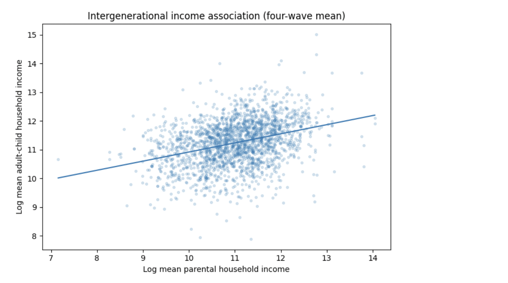
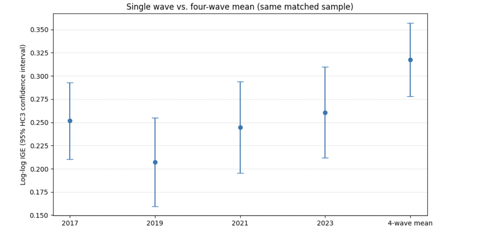
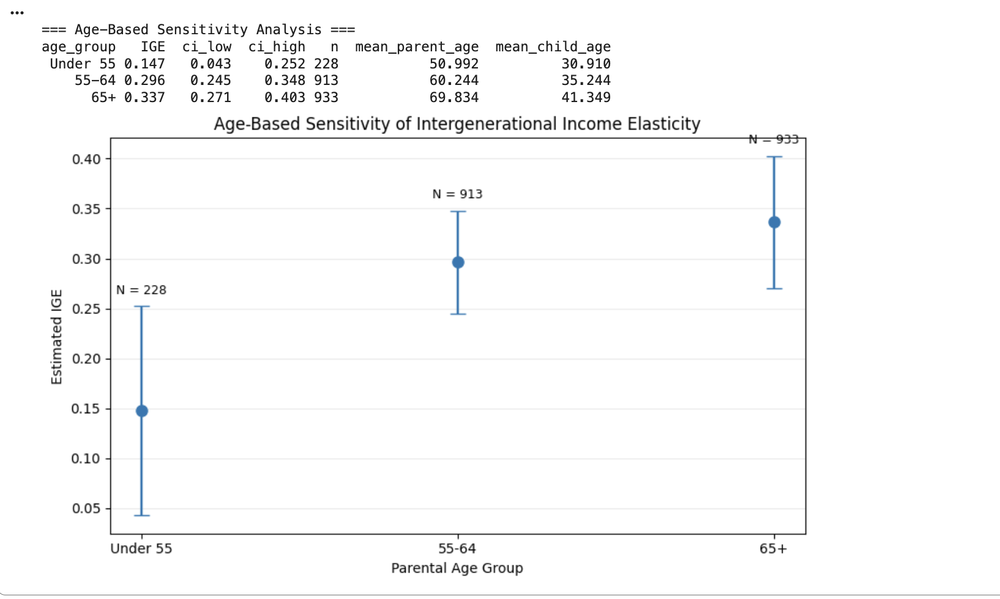

---
title: "From Family Records to Intergenerational Mobility"
subtitle: "Matching Parents and Children with SQL in Python"
author: "Yixin Yang"
date: "2026-10-23"
format:
  html:
    toc: true
    number-sections: false
    fig-cap-location: bottom
    theme: cosmo
---

*Computational Methods for Economists — Blog Post 6*

## Introduction

How strongly does parental income predict children's economic outcomes? Answering this question requires connecting individuals across generations and following their incomes over time.

In this tutorial, we use **SQL within Python** to match parents and children, construct income measures, and estimate intergenerational income elasticity (IGE). We also explore why averaging income across multiple years can provide a better measure of long-run economic status.

## Step 1: Download the Data

We use the [Panel Study of Income Dynamics (PSID)](https://psidonline.isr.umich.edu/), a longitudinal survey tracking American families across generations.

First, register for an account and open the [PSID Data Center](https://simba.isr.umich.edu/). Under **Variable Search**, select the 2017, 2019, 2021, and 2023 survey waves.

Select two categories of variables:

- **Individual-level:** permanent identifiers (`ER30001`, `ER30002`), individual age, and yearly family interview numbers.
- **Family-level:** yearly family interview numbers and total family income.

Add the variables to the Data Cart and download the customized dataset.

Next, visit the [Family Identification Mapping System (FIMS)](https://simba.isr.umich.edu/FIMS/) to generate a prospective parent-to-child relationship file. This allows us to identify family relationships even when adult children have moved into different households.

## Step 2: Match Parents and Children Using SQL

After downloading the files, we load them into Python using `pandas` and create an in-memory database with `sqlite3`.

Four SQL operations are particularly useful:

- `SELECT` retrieves identifiers, ages, and income variables.
- `JOIN` connects parent-child relationships with individual records and annual household income.
- `GROUP BY` organizes repeated observations by parent-child pair.
- `AVG()` calculates income averaged across multiple waves.

For example, after constructing a standardized annual income table, we can calculate average income using:

```sql
SELECT
    person_id,
    AVG(income) AS avg_income,
    COUNT(DISTINCT year) AS n_years
FROM person_income
WHERE income > 0
GROUP BY person_id;
```

This query calculates each individual's average observed income. We then join these summaries to the parent-child relationship table using permanent identifiers.

Before estimating the model, we check matching quality, remove invalid income observations, and exclude records where parents and adult children share the same household income.

## Step 3: Estimate Intergenerational Income Elasticity

We estimate the following log-log regression:

$$
\log(Y_{child}) =
\beta_0 + \beta_1\log(Y_{parent}) + \varepsilon
$$

Here, $\beta_1$ is the **intergenerational income elasticity (IGE)**. A higher IGE generally indicates stronger persistence of economic status across generations.

{#fig-income-association width="90%"}

Using 2,074 matched parent-child pairs, the four-wave average produces an IGE of approximately **0.318**.

## Step 4: Compare Single-Year and Multi-Year Income

Single-year income may be affected by temporary unemployment, bonuses, or other short-term fluctuations. Averaging income across multiple waves can reduce such measurement noise.

{#fig-ige-comparison width="90%"}

Single-wave IGE estimates range from **0.207 to 0.261**, below the four-wave estimate of **0.318**.

This illustrates how income measurement choices can influence estimated intergenerational persistence.

## Step 5: Explore Life-Cycle Bias

Income also changes throughout an individual's career. Consequently, the age at which income is measured may affect estimated mobility.

We divide parents into three age groups and estimate IGE separately.

{#fig-age-sensitivity width="90%"}

The estimated IGE increases from **0.147** for parents under 55 to **0.296** for ages 55–64 and **0.337** for ages 65 and above.

These differences highlight potential life-cycle measurement concerns, although age-group comparisons cannot establish causality or isolate life-cycle bias from cohort and sample-composition effects.

## Conclusion

SQL provides a transparent way to construct longitudinal parent-child matches, while Python makes regression estimation and visualization straightforward. Our results illustrate why single-year income may not fully represent long-run economic status.

Multi-wave averaging reduces some temporary fluctuations, but age differences and household composition remain important limitations.

## Reproduce This Analysis

The complete Jupyter Notebook contains the Python code, SQL queries, data-processing steps, regressions, and visualizations.

**[Download the Python Notebook (blog6.ipynb)](blog6.ipynb)**

To reproduce the workflow:

1. Download the required PSID variables and FIMS relationship file through the official websites.
2. Install the Python dependencies: `pandas`, `numpy`, `python-calamine`, `statsmodels`, and `matplotlib`.
3. Open `blog6.ipynb` and run the cells locally using appropriately authorized data.

PSID data are not redistributed with this tutorial. Users should follow the dataset's access and usage conditions.
