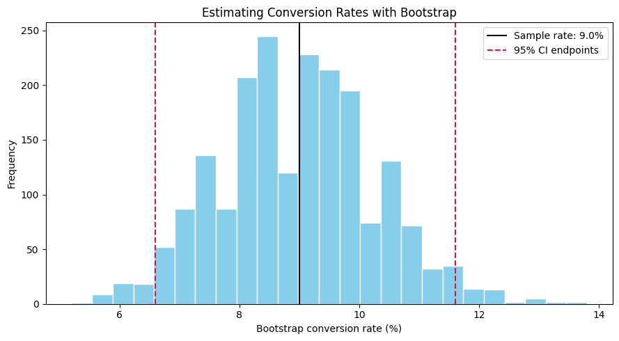
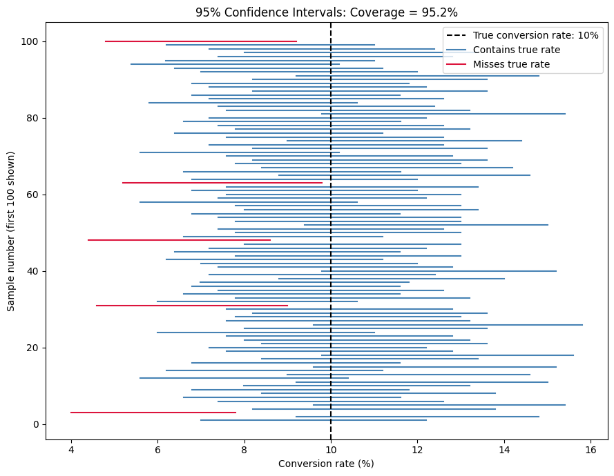
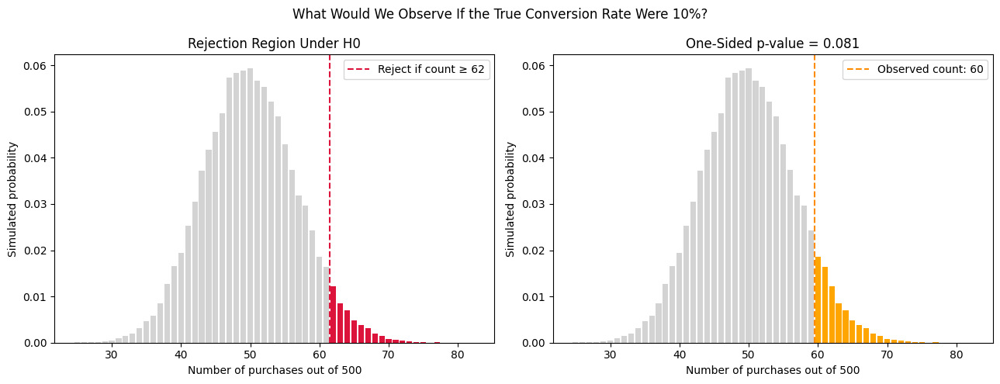

Computational Methods for Economists — Blog Post 8

An online store observes that 12% of its visitors make a purchase. Does this mean its underlying conversion rate exceeds 10%, or could the difference reflect random variation? This tutorial uses a simulated store to explain bootstrap confidence intervals, coverage, and hypothesis testing. Knowing the true population parameter allows us to check how statistical inference performs across repeated samples.

## Step 1: Construct a Bootstrap Confidence Interval

Start in Python with NumPy and Matplotlib, setting the random seed to 42 for reproducibility. Assume each visitor independently purchases with probability 0.10. Generate 500 observations, coding purchases as 1 and non-purchases as 0. Their mean is the sample conversion rate. Our initial sample contains 45 purchases, giving an estimate of 9%.

To measure uncertainty, draw 500 observations **with replacement** from this same sample and calculate their mean. Repeat this process 2,000 times. Because sampling uses replacement, an observation can appear multiple times in a bootstrap sample.

Figure 1 plots the resulting bootstrap distribution. Most estimates cluster around 9%, but they vary because each resample contains a different combination of observations. Taking the 2.5th and 97.5th percentiles produces a percentile bootstrap 95% confidence interval of **[6.6%, 11.6%]**. This interval includes the known population rate of 10%.

{#fig-bootstrap width=100%}

## Step 2: Investigate What “95% Confidence” Means

One interval cannot establish whether a method has reliable coverage. To investigate, generate 1,000 independent samples from the population. For each sample, construct a confidence interval using 1,000 bootstrap resamples, then record whether it contains 10%.

This distinction matters: bootstrap resampling repeatedly draws from one existing sample, whereas the coverage experiment repeatedly generates new samples from the population.

Of the 1,000 intervals, **952 contain the true rate**, yielding estimated coverage of **95.2%**. Figure 2 displays the first 100 intervals. Blue intervals cross the vertical line at 10%; red intervals miss it. The reported coverage uses all 1,000 intervals.

Thus, 95% confidence describes the long-run performance of the interval-building procedure. It does not assign a 95% probability to the fixed parameter lying inside one already calculated interval. Coverage is approximate and can change with the population, sample size, and interval method.

{#fig-coverage width=100%}

## Step 3: Simulate a Hypothesis Test

Now consider a separate illustrative observation: 60 purchases among 500 visitors, or 12%. This is a different teaching scenario from the initial sample. Test the null hypothesis that the population conversion rate is 10% against the one-sided alternative that it exceeds 10%:

$$
H_0: p = 0.10
\qquad \text{versus} \qquad
H_1: p > 0.10.
$$

Under the null, simulate 50,000 samples of 500 visitors and count purchases in each sample. Figure 3 shows this null distribution.

The left panel marks the simulated 5% rejection region: **62 or more purchases**. Because purchase counts are integers, its probability need not equal exactly 5%.

The right panel highlights outcomes at least as large as the observed 60 purchases. Their simulated probability, the **p-value**, is approximately **0.0807**. If the true rate were 10%, results this high or higher would occur about 8.1% of the time.

Since 0.0807 exceeds 0.05, we do not reject the null. This does not prove the rate equals 10%; the evidence is insufficient to conclude it is higher.

{#fig-testing width=100%}

Together, these simulations show how confidence intervals express estimation uncertainty and hypothesis tests assess observations against a specified null model.

## Download the Python Code

To reproduce the figures and results, download the notebook below. Run all cells in order using Python with NumPy and Matplotlib installed.

[Download the Python notebook](blog8.ipynb){download="blog8.ipynb"}