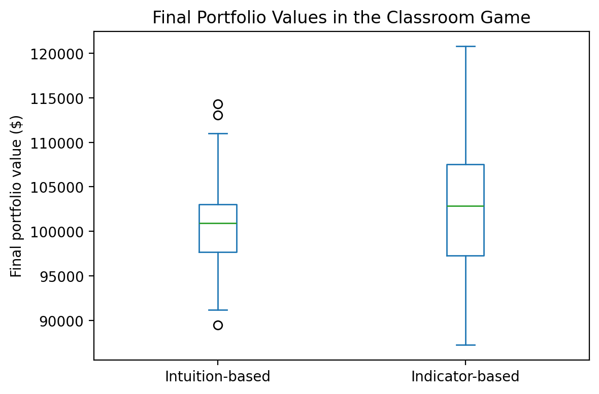
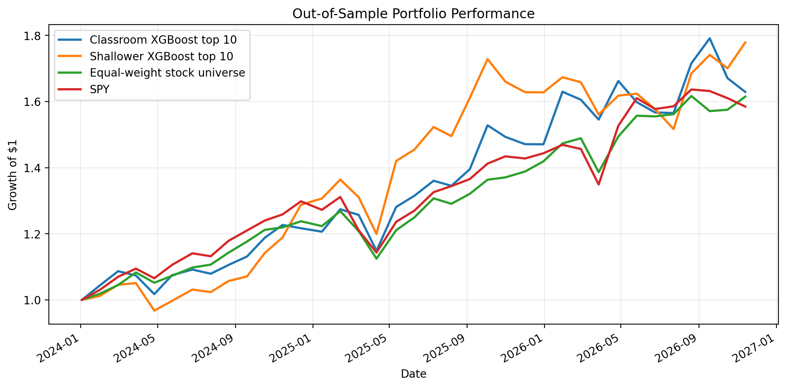

Computational Methods for Economists — Blog Post 9

## The classroom experiment

In our classroom game, 45 teams built two portfolios, one based on intuition and the other on stock indicators. The indicator-based portfolios finished at an average of $103,087, compared with $101,179 for the intuition-based portfolios. The boxplot shows a higher median and a wider spread for the indicator-based portfolios. A paired t-test gave a two-sided p-value of 0.100, so the evidence of an advantage was limited.

{width=75%}

Stock returns are difficult to forecast because prices respond to information, such as earnings surprises, that is unavailable when a forecast is made. Patterns in historical prices can also weaken as market conditions change.

## A shallower XGBoost model

I reproduced the classroom model in Python using daily Yahoo Finance data. It used price, volume, momentum, volatility, and other indicators to forecast the return from the next trading day's close to the twentieth trading day's close. I reduced the maximum tree depth from five to two while holding the other model settings fixed. Deeper trees can learn more specific combinations of signals. If those combinations reflect noise in the training period, a shallower tree may perform better on future data.

Both models were trained on observations whose forward returns were fully known before January 2024 and evaluated on the same observations from January 2024 onward. The simple benchmark used the same training-period average return as its forecast for every stock.

## Out-of-sample prediction accuracy

| Model | MAE (percentage points) | RMSE (percentage points) |
|:--|--:|--:|
| Historical mean | 6.426 | 8.887 |
| Classroom XGBoost (depth 5) | 6.849 | 9.371 |
| Shallower XGBoost (depth 2) | 6.645 | 9.126 |

The shallower model reduced mean absolute error by about 3% relative to the classroom model. It also reduced RMSE, which gives larger errors more weight. The historical mean produced the lowest error on both measures.

## Portfolio performance

Every 20 trading sessions, I formed an equal-weight portfolio of each model's ten highest-ranked stocks. I compared the portfolios with an equal-weight stock universe and SPY over the same holding windows.

{width=100%}

Across 36 holding periods, the shallow-tree portfolio gained 77.86%, compared with 62.91% for the classroom model, 61.50% for the equal-weight stock universe, and 58.48% for SPY. Forecast errors measure how close predictions are to realized returns across all stocks. The trading rule only uses the top of the ranking. The historical mean can forecast reasonably well by predicting a typical return, but its identical forecasts cannot distinguish among stocks. The shallow model's top picks earned the highest return in this backtest. Whether that advantage would persist after trading costs or in another test period remains open.

## Downloads

- [Download the Python notebook (.ipynb)](blog9.ipynb)
- [Download the prediction metrics (.csv)](prediction_metrics.csv)